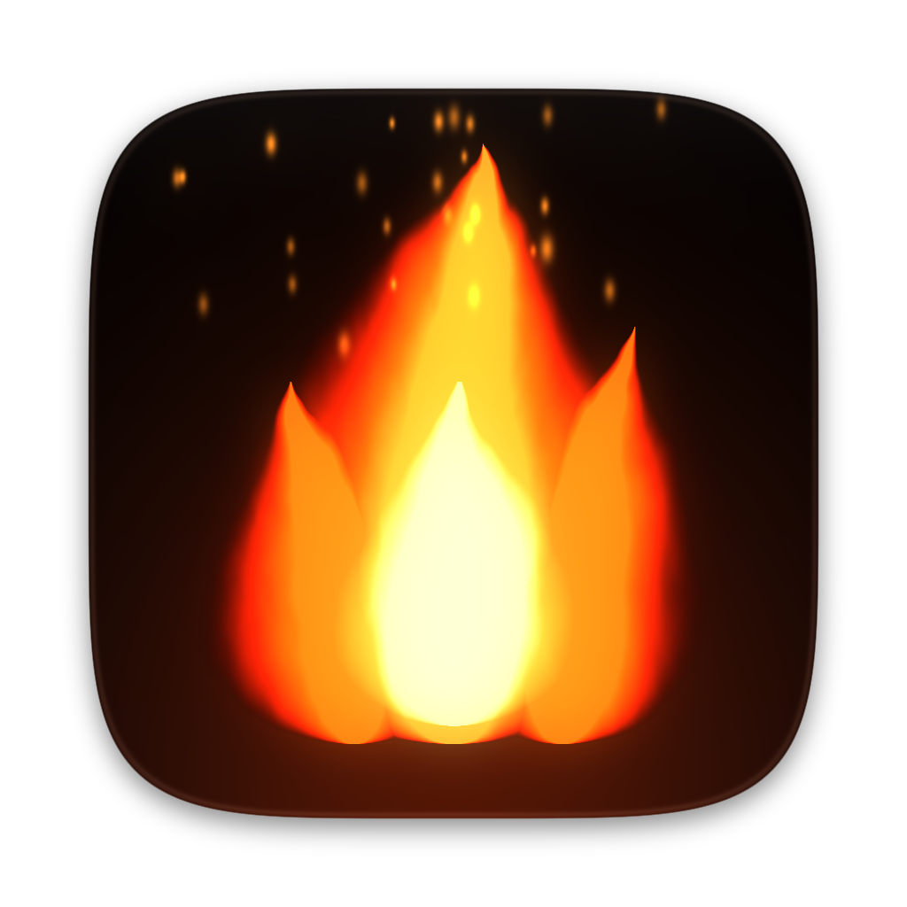

<p align="center">
  
</p>

<h1 align="center">TempMonitor</h1>

<p align="center">
  A native macOS app (SwiftUI + Metal) that shows and monitors CPU and GPU temperature,<br>
  CPU and memory usage, and records the whole session as CSV or as a graph.
</p>

---

## Download

Get the latest version from the [**Releases**](https://github.com/lydianb79/TempMonitor/releases) page:

| Your Mac | File |
|---|---|
| Apple Silicon (M1, M2, M3, M4) | `TempMonitor-<version>-AppleSilicon-arm64.zip` |
| Intel | `TempMonitor-<version>-Intel-x86_64.zip` |

Unzip it and drag **TempMonitor.app** into Applications. It requires **macOS 12 Monterey or later**.

The app is ad-hoc signed and not notarized by Apple. The first time you open it, right-click it and choose
**Open**, or run:

```bash
xattr -dr com.apple.quarantine /Applications/TempMonitor.app
```

Not sure which one you need? Apple menu → **About This Mac**: "Chip: Apple M…" means Apple Silicon,
"Processor: Intel…" means Intel.

## Features

**Temperature**
- CPU and GPU cards with a ring gauge, status (Cool / Normal / Warm / Hot / Critical), hottest sensor,
  session min/max and a 2-minute history line
- Grid of every individual sensor, colour-coded
- °C or °F

**Usage**
- CPU usage: overall load plus a bar for each core
- Memory usage: used / total in %, with App, Wired, Compressed and Swap (counted like Activity Monitor)

**Look and feel**
- Full-window animated **Metal** fire background that grows taller, brighter and faster as the Mac heats up
- Dark glass cards; the window content scrolls if the window is small
- Menu bar readout, e.g. `CPU 52° 23%  GPU 47°  MEM 61%`, which stays while the window is closed
- Update interval from 0.5 to 5 s

**Recording and export**
- Every reading is recorded while the app is open, with pause and resume
- Export as **CSV** (⌘S), or as a **graph** in PNG (⇧⌘S) or PDF
- Optional auto-save of CSV + graph when quitting

## Using the app

| Control | What it does |
|---|---|
| **REC** pill in the header | Shows recording time. Click to pause or resume |
| ⬇︎ menu next to it | Export CSV, export graph (PNG / PDF), open the logs folder, auto-save on quit, clear history |
| Interval picker | How often sensors are read (0.5 s, 1 s, 2 s, 5 s) |
| °C / °F | Temperature unit for the window, menu bar and graph |
| ☰ button | Show or hide the individual sensor grid |
| ↺ button | Reset session min / max |
| Menu bar 🔥 item | Show the window, export history or graph, quit |

Exports are saved to `~/Documents/TempMonitor/` by default.

### CSV format

```
timestamp, elapsed_s, cpu_avg_C, gpu_avg_C, cpu_usage_pct, mem_usage_pct, <one column per sensor>
```

Temperatures in the CSV are always in °C. The file opens directly in Numbers or Excel.
History is kept in memory for up to about 500,000 samples (around 5.8 days at a 1 s interval).

### Graph

The exported graph has two charts on a shared timeline:

1. **Temperature**: CPU (orange) and GPU (blue), in your chosen unit
2. **Usage**: CPU (orange) and memory (purple), 0–100 %

Each chart shows peak markers and avg / max / min for every line. Lines break where recording was paused.
The PNG is 2800×2300 px; the PDF scales without losing sharpness.

## Building from source

You need the Xcode Command Line Tools (`xcode-select --install`). The full Xcode app is not required.

```bash
git clone https://github.com/lydianb79/TempMonitor.git
cd TempMonitor
bash build.sh              # Apple Silicon and Intel versions
bash build.sh arm64        # Apple Silicon only
bash build.sh x86_64       # Intel only
bash build.sh universal    # both, plus one universal app that runs on either
```

| Version | App | Zip |
|---|---|---|
| Apple Silicon | `dist/arm64/TempMonitor.app` | `dist/TempMonitor-arm64.zip` |
| Intel | `dist/x86_64/TempMonitor.app` | `dist/TempMonitor-x86_64.zip` |
| Universal | `dist/universal/TempMonitor.app` | `dist/TempMonitor-universal.zip` |

Open the `.app` bundles in `dist/`. The files in the hidden `.build/` folder are bare executables that
open in Terminal.

## Publishing a release

`release.sh` uploads the built zips as a GitHub release, with release notes and SHA-256 checksums:

```bash
bash build.sh
bash release.sh 1.1        # creates tag v1.1 and the release "TempMonitor 1.1"
```

It needs the [GitHub CLI](https://cli.github.com) (`brew install gh`), logged in with access to create
releases. Use `gh auth login --web`, or a token with **Contents: Read and write** (fine-grained) or
`public_repo` (classic).

## Project layout

```
Sources/
  TempMonitorApp.swift      app entry, window, menu bar item, File menu commands
  ContentView.swift         dashboard UI: cards, ring gauges, core bars, sparklines, sensor grid
  FlameBackground.swift     MTKView + Metal fire shader (compiled at runtime)
  TemperatureMonitor.swift  polling, statistics, history
  SensorHub.swift           temperature sensor discovery and classification
  SystemUsage.swift         CPU load (per core) and memory usage via Mach APIs
  HistoryRecorder.swift     session recording and CSV export
  GraphRenderer.swift       PNG / PDF graph export (Core Graphics)
  Theme.swift               colours, units, formatting
  C/sensors.h, smc.c, hid.c AppleSMC + IOHID access (Swift bridging header)
Resources/
  Info.plist, AppIcon.icns, AppIcon-1024.png, AppIcon.iconset/
Tools/make_icon.py          regenerates the icon (python3 + numpy + Pillow)
build.sh                    builds arm64 / x86_64 / universal app bundles
release.sh                  publishes a GitHub release
```

## How it works

- **Temperatures** come from the System Management Controller (SMC) through IOKit. Apple doesn't document
  the sensor keys and they differ by chip, so the app reads every SMC key at launch and keeps those that return
  plausible temperatures:
  - Apple Silicon: `Tp*` / `Te*` (performance / efficiency cores), `Tg*` (GPU), `Tf*` on M3. IOHID sensors
    fill in where the SMC has none.
  - Intel: `TC*C` cores (or `TC0D` / `TC0P`), `TG*` for a dedicated GPU, `TCGC` for integrated graphics.
  - The CPU and GPU values shown are averages of their sensors; "Hottest sensor" is the single highest one.
- **CPU usage** is calculated from per-core tick counters between two readings; **memory** from the kernel's
  VM statistics (App + Wired + Compressed, like Activity Monitor's "Memory Used").
- The Metal shader is compiled when the app starts, so no Metal toolchain is needed to build.
- The chip type is detected at runtime, so the Intel build also reads the right sensors on Apple Silicon
  under Rosetta.

## Notes

- The app isn't sandboxed, because reading the SMC needs direct IOKit access. It doesn't need administrator rights.
- On a chip whose sensors aren't recognised, the CPU or GPU card shows `--`. Please open an issue with your chip
  and the sensor names from the sensor grid.
